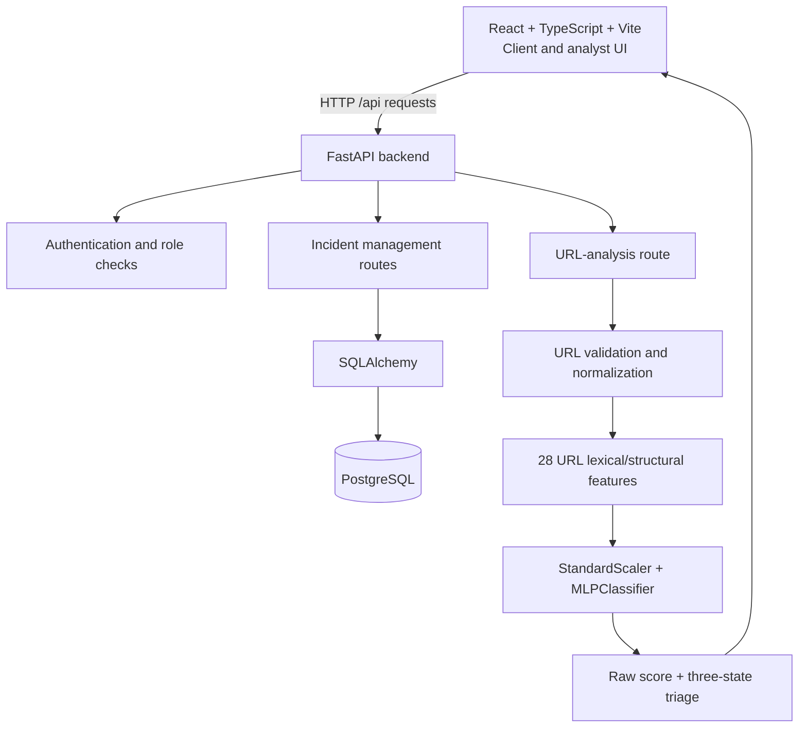

# ThreatLens AI

**AI-assisted cybersecurity incident management with experimental phishing-URL triage.**

ThreatLens AI is an academic project that brings incident reporting, analyst triage, and URL-structure analysis into one web application. Clients can submit incidents and choose an initial priority. Analysts can review the queue, assign incidents, update status and reprioritize cases. An integrated machine-learning service analyzes URL strings and provides an advisory phishing-triage result. Human review remains essential.

> **Project status: working academic/demo application.** The incident-management application and the URL MLP inference integration are implemented. The URL model is explicitly experimental and is not validated for live operational decisions. Multimodal email/text/image models, automatic AI priority assignment, and several enterprise SOC features are future work—not current capabilities.

## Contents

- [Implemented features](#implemented-features)
- [Architecture](#architecture)
- [Technology stack](#technology-stack)
- [Project layout](#project-layout)
- [Requirements](#requirements)
- [Run locally with Docker Compose](#run-locally-with-docker-compose)
- [URL model artifacts](#url-model-artifacts)
- [Application workflows](#application-workflows)
- [API overview](#api-overview)
- [Testing](#testing)
- [How the URL model works](#how-the-url-model-works)
- [Limitations and security notes](#limitations-and-security-notes)
- [Roadmap](#roadmap)
- [License](#license)

## Implemented features

### Client workspace

- Register a client account and sign in.
- Submit a security incident with type, title, description, optional evidence reference, and manually selected initial priority.
- View the client's own incidents and see status/priority updates.
- Use the URL Analyzer and prefill a suspicious-URL incident report from its output.

### Analyst workspace

- View the incident Command Center and Incident Queue.
- Filter and sort incident records and use queue scope controls.
- Assign incidents, update their status, and revise priority.
- Review priority levels P1–P4 and investigation status labels.
- View incident-derived charts and queue indicators. The queue-pressure gauge is a weighted score calculated from the currently loaded incidents; it is not an independent threat metric.

### URL analysis

- Validate and normalize an HTTP(S) URL string.
- Extract 28 lexical and structural features from the URL.
- Run a trained Scikit-learn MLP pipeline and return a raw phishing score, triage label, thresholds, contextual signals, and explanatory warning.
- Use three triage states: `low_signal`, `uncertain`, and `phishing`.
- Display explicit warnings that the model is experimental and its output requires human review.

### Platform foundation

- React + TypeScript frontend with responsive client and analyst views.
- FastAPI backend with Pydantic validation and role checks.
- PostgreSQL database accessed through SQLAlchemy.
- Password hashing and JWT-based authenticated API requests.
- Docker Compose development environment with persistent PostgreSQL volume.
- Automated backend tests.

## Architecture



Docker Compose runs three services:

| Service | Purpose | Local address |
|---|---|---|
| `threatlens-web` | Vite frontend development server | <http://localhost:5173> |
| `threatlens-api` | FastAPI API and interactive Swagger documentation | <http://localhost:8000> / <http://localhost:8000/docs> |
| `threatlens-db` | PostgreSQL database | `localhost:5432` |

The Vite development server proxies `/api` requests to the backend service. PostgreSQL data is stored in the named Docker volume `threatlens-postgres-data`.

## Technology stack

| Area | Technology |
|---|---|
| Frontend | React, TypeScript, Vite, CSS, hand-built SVG charts |
| Backend | Python, FastAPI, Pydantic, SQLAlchemy |
| Authentication | Password hashing with `pwdlib`; signed JWT access tokens with PyJWT |
| Database | PostgreSQL, `psycopg` driver |
| Machine learning | Scikit-learn `MLPClassifier`, `StandardScaler`, NumPy, Pandas, joblib |
| Dataset/training utilities | UCI ML Repository client, public Hugging Face dataset files, PyArrow, `tldextract` |
| Local development | Docker, Docker Compose, Git, GitHub |

## Project layout

```text
threatlens-ai/
├── backend/
│   ├── app/
│   │   ├── api/routes/       # Auth, incident and URL-analysis endpoints
│   │   ├── models/           # SQLAlchemy User and Incident models
│   │   ├── schemas/          # Pydantic request/response schemas
│   │   ├── services/         # URL features and model inference
│   │   ├── config.py         # Application settings
│   │   ├── database.py       # SQLAlchemy engine/session
│   │   └── security.py       # Password hashing and JWT handling
│   ├── ml/                   # Training, evaluation and candidate-check scripts
│   ├── models/               # Local model binaries/metrics (not committed)
│   ├── tests/                # Backend tests
│   ├── Dockerfile
│   └── requirements.txt
├── frontend/
│   ├── src/
│   │   ├── components/       # Auth, shell, client/analyst views, charts, panels
│   │   ├── App.tsx           # Application state and API handlers
│   │   ├── lib.ts            # Shared UI helpers
│   │   ├── types.ts          # Shared frontend types
│   │   └── index.css         # Design system and responsive styling
│   ├── package.json
│   ├── package-lock.json
│   ├── vite.config.ts
│   └── Dockerfile
├── docs/                     # Model-audit notes
├── docker-compose.yml
├── .env.example              # Safe configuration template
├── .gitignore
├── LICENSE
└── README.md
```

## Requirements

- Docker Desktop with Docker Compose support.
- Git, if cloning the repository.
- Internet access for pulling container images and, if needed, downloading the training datasets.
- Compatible local URL-model artifacts if you want URL inference immediately; see [URL model artifacts](#url-model-artifacts).

## Run locally with Docker Compose

### 1. Clone the repository

```powershell
git clone https://github.com/Parth-Singhh/threatlens-ai.git
cd threatlens-ai
```

### 2. Create your local environment file

```powershell
Copy-Item .env.example .env
```

Open `.env` and replace the placeholder values with your own. Use a strong, random value for both `POSTGRES_PASSWORD` and `SECRET_KEY`. Do not commit `.env`.

Example variable names (use private values locally; do not copy example placeholders as production secrets):

```dotenv
POSTGRES_PASSWORD=replace-with-a-strong-random-password
SECRET_KEY=replace-with-a-long-random-signing-key
THREATLENS_URL_MODEL_MODE=experimental-v4
THREATLENS_URL_LOW_SCORE_THRESHOLD=0.20
```

**Important:** Compose uses `POSTGRES_PASSWORD` when the PostgreSQL data directory is initialized for the first time. If reusing an already initialized database volume, changing the variable alone does not change the database user's existing password. Do not remove the volume to resolve a password issue unless you intentionally want to delete local database data.

### 3. Start the application

```powershell
docker compose up --build -d
```

Check service status:

```powershell
docker compose ps
```

Open:

- Frontend: <http://localhost:5173>
- API health: <http://localhost:8000/api/health>
- Swagger UI: <http://localhost:8000/docs>

Stop the services without deleting database data:

```powershell
docker compose down
```

Avoid `docker compose down -v` unless you intentionally want to delete the named PostgreSQL volume and the data stored in it.

### 4. Frontend-only development/build

From the repository root:

```powershell
cd frontend
npm ci
npm run build
```

`npm run build` runs the TypeScript project build (`tsc -b`) and Vite production bundling. Return to the repository root before running Docker Compose commands.

## URL model artifacts

Model binaries and metrics are deliberately excluded from Git by `.gitignore`. Therefore, cloning the source repository does **not** by itself provide all files needed to run URL inference.

In the default `experimental-v4` mode, the API expects these files under `backend/models/`:

```text
backend/models/
├── url_mlp_v4_candidate.joblib
└── url_mlp_v4_candidate_metrics.json
```

If these compatible artifacts are absent, the application and incident-management workflows can still start, but `/api/analysis/url` returns a service-unavailable response until a compatible model and metrics file are supplied.

To train a new v4 candidate from the training sources configured in the repository, start the backend container and run:

```powershell
docker exec -it threatlens-api python ml/train_url_model_mixed.py
```

Run the candidate's compatibility and regression checks:

```powershell
docker exec -it threatlens-api python ml/check_url_model_v4_candidate.py
```

These steps require network access to the configured public dataset sources and may take time. Training writes a **candidate** artifact; it does not by itself establish production readiness. Review the generated metrics and the independent-evaluation requirement before using any model operationally. The backend mounts `./backend/models` into the container, so generated artifacts are available on the host and persist across container rebuilds.

The current local demo configuration explicitly selects `experimental-v4`. Production mode expects separately prepared `url_mlp.joblib` and `url_mlp_metrics.json` artifacts with valid promotion/validation metadata. Do not switch to production mode merely to suppress the experimental warning.

## Application workflows

### Client workflow

1. Register a client account or sign in.
2. Open the incident-report drawer and select an incident type.
3. Enter a title and description, optionally provide an evidence reference, and choose initial priority P1, P2, P3, or P4.
4. Submit the report. The backend validates it and stores the incident in PostgreSQL.
5. View the incident and track the status and priority updates made by staff.
6. Optionally analyze a URL and use its result to prefill a suspicious-URL report.

### Analyst workflow

1. Sign in with an analyst account provisioned in the development environment.
2. Review the Command Center and Incident Queue.
3. Use queue filters/sorting and open incident details.
4. Assign an analyst and update incident status or priority.
5. Changes are sent through the protected API and saved to the database.

Registration currently creates **client** accounts only. There is no complete administrator user-management interface in the current frontend; analyst/admin accounts must be provisioned separately for a development/demo environment.

### Priority and status values

| Priority | Meaning |
|---|---|
| P1 | Critical |
| P2 | High |
| P3 | Medium (API default if a client omits priority) |
| P4 | Low |

Supported incident statuses are `submitted`, `assigned`, `investigating`, `escalated`, `waiting`, `resolved`, and `closed`. The backend verifies that an assigned user is an active analyst. Assigning an analyst to a newly submitted case can move its status to `assigned`.

The client and analyst use the same stored `priority` field: when an analyst changes priority, the earlier client-selected value is overwritten. Separate priority history/audit tracking is not implemented yet.

## API overview

All paths below are served by the FastAPI backend. Protected routes require a valid bearer token, except registration, login, and health checks.

| Method | Path | Purpose |
|---|---|---|
| `GET` | `/` | API name, version, status |
| `GET` | `/api/health` | API/database health status |
| `POST` | `/api/auth/register` | Register a client account |
| `POST` | `/api/auth/login` | Verify credentials and return a JWT access token |
| `GET` | `/api/auth/me` | Return current authenticated user |
| `POST` | `/api/incidents` | Create an incident as a client |
| `GET` | `/api/incidents` | List incidents; clients see their own, staff see the queue |
| `GET` | `/api/incidents/{incident_id}` | Fetch one incident, with client ownership checks |
| `PATCH` | `/api/incidents/{incident_id}` | Authorized staff update status, assignment, and/or priority |
| `POST` | `/api/analysis/url` | Authenticated URL analysis using the configured model |

Full schemas and interactive requests/responses are available at <http://localhost:8000/docs> while the backend is running.

## Testing

Run the backend test suite in the running backend container:

```powershell
docker exec -it threatlens-api pytest -q
```

Run the frontend TypeScript and production build checks:

```powershell
cd frontend
npm ci
npm run build
```

Tests cover schema/validation, URL normalization/features, model triage decisions, and other backend behavior. Re-run the checks after code or dependency changes; passing tests are not a substitute for a full security review or live-system validation.

## How the URL model works

1. **Input validation and normalization:** accepts HTTP(S) URLs (a missing scheme is normalized for compatibility), rejects unsupported schemes and malformed inputs, and canonicalizes certain formatting differences.
2. **Feature extraction:** constructs 28 numeric lexical/structural features including URL/host/path/query lengths, hostname structure, character counts/ratios, IP/port/punycode indicators, suspicious-term count, shortener indicator, path depth, query count, and host-character entropy.
3. **Scaling:** a `StandardScaler` fitted during training transforms the feature vector.
4. **Classification:** a Scikit-learn `MLPClassifier` with hidden layers `(64, 32)`, ReLU activation and Adam optimizer produces class scores.
5. **Triage policy:** the raw score is compared with a low-score cutoff and a validation-selected high cutoff. With the current v4 demo, the low cutoff is `0.20` and the high cutoff comes from the candidate metrics metadata (approximately `0.82` in the evaluated run).
6. **Response:** the API returns the normalized URL, raw phishing score, triage label, risk label, model mode/name, threshold values, contextual signals, and warning text.

The mixed-source trainer uses UCI PhiUSIIL (dataset ID 967) and `flwrlabs/fed-phishing-urls`. It maps both sources into the internal convention `0 = legitimate/benign`, `1 = phishing`, excludes conflicting canonical-label groups, and uses Public Suffix List-aware registered-domain-separated train/validation/test splits to reduce domain leakage. Candidate training, evaluation metrics, and preliminary regression checks are implemented in `backend/ml/`.

### Interpreting the output correctly

- The field called `phishing_probability` is the model's raw class score; it is **not calibrated** to mean a real-world probability that the submitted URL is malicious.
- `phishing` means the URL crossed the configured threshold and should be reviewed—not that maliciousness has been confirmed.
- `low_signal` is not a guarantee of safety.
- Intermediate scores are `uncertain` and require additional investigation.
- The model inspects the URL string only. It does not visit the website, follow redirects, check current reputation, render the page, or inspect page content.
- Public dataset labels may be stale/noisy. Contemporary independent evaluation is required before operational use.

## Limitations and security notes

ThreatLens AI is an academic/development demo, not a replacement for a SOC or professional security tools. In particular:

- The URL MLP is experimental and not validated for live security decisions.
- LSTM-based email/message analysis, CNN-based screenshot analysis, and multimodal feature fusion are planned, not implemented.
- Incident priority is selected by the client and can be changed by an analyst; the URL model does not assign incident priority.
- File uploads, automatic scanning of every submitted incident, notifications, complete administrator management, and a comprehensive audit/event log are not implemented as full features.
- The initial schema is created with SQLAlchemy `create_all`; a formal database migration system should be added before production.
- Use HTTPS, strong deployment-specific secrets, restricted network exposure, an explicit token/session security policy, logging/monitoring, backups, and a security review before any real-world deployment.
- Never commit `.env`, credentials, dataset dumps, or model artifacts containing private data. `.env.example` is a template only.

## Roadmap

Potential next milestones include:

- Improve the README/demo documentation as features change.
- Add formal schema migrations and stronger integration/end-to-end tests.
- Improve priority history and incident activity/audit records.
- Conduct independent contemporary URL-model evaluation and revisit calibration/threshold policy.
- Add file upload/evidence handling with access controls.
- Explore separately evaluated email/text and screenshot models, then consider multimodal fusion only if the project scope and datasets support it.
- Add deployment hardening, monitoring, backups, and automated build/test checks.

## License

This project is licensed under the MIT License. See [`LICENSE`](LICENSE) for details.

## Author

**Parth Singh**  
B.Tech — Cyber Security  
Amrita Vishwa Vidyapeetham
